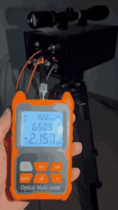

# LightWing: An Optical-Communication (FSO) Environmental Mapping Drone for EMI Environments

## Photo gallery and demos

All 11 photographs and measurement plots from the FSO source are displayed below. Select any image to open the original full-resolution file.

### Optical-terminal and rooftop photographs

| | |
|---|---|
| [](fso-field-experiment/images/fso_optical_terminal_closeup_01.jpg) | [](fso-field-experiment/images/fso_optical_terminal_closeup_02.jpg) |
| **Optical terminal close-up 01** | **Optical terminal close-up 02** |
| [](fso-field-experiment/images/fso_optical_terminal_closeup_03.jpg) | [](fso-field-experiment/images/fso_rooftop_link_overview_01.jpg) |
| **Optical terminal close-up 03** | **Rooftop link overview 01** |
| [](fso-field-experiment/images/fso_rooftop_link_overview_02.jpg) | |
| **Rooftop link overview 02** | |

### Measurement plots

| | |
|---|---|
| [](fso-field-experiment/images/Loss_1.png) | [](fso-field-experiment/images/Loss_2.png) |
| **Loss 1** | **Loss 2** |
| [](fso-field-experiment/images/RTT_1.png) | [](fso-field-experiment/images/Throughput_1.png) |
| **RTT 1** | **Throughput 1** |
| [](fso-field-experiment/images/Throughput_2.png) | [](fso-field-experiment/images/Throughput_3.png) |
| **Throughput 2** | **Throughput 3** |

### Video demo

[](fso-field-experiment/videos/power_fluctuation_01_compressed.mp4)

The complete 21-second video plays as an animated preview directly in this README. Select the preview to open the compressed H.264 MP4 with audio. The [unaltered source MP4](fso-field-experiment/videos/power%20fluctuation_01.mp4) is also preserved for provenance.

### Runnable prototype entry points

The SecurIR source contains executable code rather than prerecorded demo videos:

- [Launch the SecurIR Python host GUI](securir-comms/host/gui_app.py) — install the requirements and run the commands in [Run the SecurIR prototype](#run-the-securir-prototype).
- [ESP32 transmitter demo (Arduino)](securir-comms/firmware/arduino/tx/tx.ino)
- [ESP32 receiver demo (Arduino)](securir-comms/firmware/arduino/rx/rx.ino)
- [ESP-IDF transmitter implementation](securir-comms/firmware/tx/main/main.c)
- [ESP-IDF receiver implementation](securir-comms/firmware/rx/main/main.c)
- [Complete hardware and demo run guide](securir-comms/docs/run_guide.md)

## System concept and engineering mechanism

LightWing is an engineering reference architecture for an unmanned aerial vehicle (UAV) that uses a **Free-Space Optical (FSO)** link as a high-directionality data channel in electromagnetically congested or radio-restricted environments. The present repository provides an ESP32-based infrared optical-link prototype, its host-side telemetry software, and FSO field materials. Airframe integration, autonomous navigation, stabilized optical pointing, and environmental-mapping payloads are described below as the target system architecture; those subsystems are not implemented by the current source tree.

### Functional architecture

| Layer | Engineering function | Repository baseline / integration requirement |
|---|---|---|
| Perception payload | Captures RGB, thermal-infrared, multispectral, LiDAR/ToF, gas-sensor, or radiation-sensor observations for disaster assessment | Payload-dependent integration; no mapping sensor driver is included here |
| Navigation and timing | Fuses GNSS, inertial measurement unit (IMU), barometer, magnetometer, and visual-inertial odometry; timestamps observations against vehicle pose | Requires autopilot and companion-computer integration |
| Onboard processing | Performs geotagging, image tiling, feature extraction, semantic segmentation, change detection, SLAM, or orthomosaic preparation | Proposed companion-computer pipeline; not part of the ESP32 prototype |
| Optical physical layer | Converts framed data into 38 kHz carrier bursts over an 850/940 nm infrared emitter using On-Off Keying (OOK) and Manchester line coding | Implemented in the SecurIR transmitter/receiver firmware |
| Data-link integrity | Uses preamble acquisition, synchronization word detection, sequence numbering, payload-length validation, CRC16-CCITT, and optional Hamming(7,4) forward-error-correction helpers | Framing and CRC paths are implemented; stronger FEC/interleaving remain upgrade points |
| Ground segment | Controls TX/RX serial ports, visualizes link-quality telemetry, and records RSSI proxy, BER trend, eye-like samples, and CSV logs | Implemented by the Python host GUI |

### Optical communication chain

1. **Frame construction.** The host or transmitter firmware packages each payload as eight `0x55` preamble bytes, a `0xD3 0x91` synchronization word, sequence/flags/length fields, up to 200 payload bytes, and a CRC16-CCITT integrity word. This allows the receiver state machine to distinguish valid frames from ambient-light transients and partial acquisitions.
2. **Line coding and modulation.** Raw frame bits are Manchester encoded to maintain regular transitions and improve clock recovery. The encoded marks gate a nominal 38 kHz infrared carrier, producing OOK carrier bursts compatible with the VS1838B demodulating receiver. The current firmware exposes a configurable 500–10,000 bit/s range and uses 2 kbit/s as the practical demonstration setting.
3. **Electro-optical transmission.** ESP32 `GPIO18` drives an NPN or logic-level N-MOSFET low-side switch rather than sourcing LED pulse current directly. The driver controls an 850/940 nm IR emitter through a current-limiting network, with local decoupling and firmware duty-cycle guardrails to manage junction temperature and average optical power.
4. **Free-space channel.** The optical beam propagates through a line-of-sight channel governed by transmitter divergence, aperture area, range, atmospheric extinction, receiver field of view, platform vibration, and pointing error. Unlike an omnidirectional RF channel, an FSO link concentrates energy spatially and creates a comparatively small interception footprint, but it is sensitive to occlusion and misalignment.
5. **Opto-electronic reception.** A VS1838B front end detects 38 kHz bursts and presents an active-low digital signal to ESP32 `GPIO14`. The receiver searches for the preamble and sync word, reconstructs Manchester symbols, validates frame length and CRC, and exports telemetry to the host at 115200 baud.
6. **Supervision and logging.** The Python GUI sends bitrate, pattern, and payload commands; plots RSSI/BER proxies and eye-like traces; and persists session data for repeatable range, alignment, and ambient-light experiments.

For a future collimated outdoor terminal, a first-order received-power model can be written as:

```text
P_r ≈ P_t · η_t · η_r · [A_r / (π(R·θ/2)²)] · exp(-σR) · L_pointing
```

where `P_t` is launched optical power, `η_t` and `η_r` are terminal efficiencies, `A_r` is receive-aperture area, `R` is slant range, `θ` is full-angle beam divergence, `σ` is the atmospheric extinction coefficient, and `L_pointing` represents acquisition/tracking loss. A usable link requires positive **link margin** after photodetector sensitivity, background-shot-noise, scintillation, coding gain, and implementation losses are included. This equation is a design model, not a measured performance claim for the current LED/VS1838B prototype.

### UAV pointing, navigation, and mapping architecture

A flight-capable implementation would require a **Pointing, Acquisition, and Tracking (PAT)** subsystem. Coarse pointing can be derived from GNSS/IMU relative geometry and vehicle attitude, while a two-axis gimbal or fast-steering optical element compensates for roll/pitch/yaw motion. Fine tracking can close the loop on beacon centroid error or received-signal-strength feedback. Beam divergence and receiver field of view must be selected as a trade-off: a narrow beam improves geometric link gain and low-probability-of-intercept characteristics, while a wider beam increases tolerance to jitter and attitude-estimation error.

The environmental-mapping data path would typically be:

```text
sensor exposure → hardware timestamp → pose interpolation → coordinate-frame transform
→ georeferencing / map tile generation → confidence scoring → optical packetization
→ ground-station reconstruction → GIS / incident-command display
```

Reliable geospatial products require calibrated camera intrinsics/extrinsics, a defined ENU or NED navigation frame, synchronized sensor and autopilot clocks, uncertainty propagation, and quality flags for GNSS degradation, motion blur, occlusion, and packet loss. For GNSS-denied operations, visual-inertial odometry or LiDAR SLAM could provide local pose estimates, followed by loop closure and later registration to an absolute map.

## Disaster-response concept of operations

The following are prospective **Concept of Operations (CONOPS)** examples, not claims of completed emergency deployments:

- **Earthquake and structural-collapse reconnaissance.** A UAV could image roof voids, facade cracking, blocked access routes, and unstable debris while relaying selected frames over a narrow optical link to a rooftop or mast-mounted terminal. Geotagged annotations could help an incident-command team prioritize canine units, structural engineers, or medical extraction teams without adding traffic to an already congested RF environment.
- **Flood and typhoon assessment.** A mapping payload could survey isolated rooftops, damaged bridges, washed-out roads, and temporary shelter routes. Store-and-forward buffering would preserve observations whenever rain, spray, aircraft attitude, or moving obstacles interrupt the optical channel; once PAT lock is recovered, prioritized thumbnails and coordinates could be sent before full-resolution imagery.
- **Wildfire perimeter and hotspot monitoring.** When equipped with a thermal camera, a future airframe could identify residual hotspots, spot-fire formation, or threatened evacuation corridors. Smoke and aerosols can severely attenuate optical propagation, so this use case would require shorter optical hops, elevated ground terminals, quantitative visibility monitoring, and a redundant safety/control link.
- **Industrial accident and hazardous-material reconnaissance.** A modular payload could carry thermal, volatile-organic-compound, particulate, or radiation sensors into areas unsafe for responders. The optical data path could reduce reliance on RF telemetry near sensitive instrumentation, but the aircraft would still require hazardous-location assessment; an optical link alone does not provide intrinsic-safety certification.
- **Power-substation and grid-restoration inspection.** In high-field or RF-sensitive areas, the platform could collect insulator, conductor, transformer, and thermal-anomaly imagery while avoiding additional RF spectral occupancy. Surge immunity, magnetic-field tolerance, stand-off distance, and conductive-structure collision avoidance would remain essential engineering constraints.
- **Tunnel, mine, and urban-canyon search.** A chain of stationary optical relay nodes could create segmented line-of-sight hops where direct RF propagation is unreliable. Each relay could implement buffering, sequence-aware forwarding, and link-health telemetry; turns, dust, moving personnel, and smoke would require deliberate terminal placement and path redundancy.
- **Temporary incident-area data bridge.** Two stabilized terminals—one on a UAV and one on a command vehicle, rooftop, or portable mast—could provide a directional backhaul for map tiles, still images, or sensor alerts when conventional infrastructure is damaged. Traffic scheduling could prioritize coordinates and alarms over bulk imagery according to latency and mission criticality.

### Engineering validation roadmap

1. **Bench optical link:** verify continuous frame acquisition, CRC pass rate, bitrate fallback, CSV logging, and controlled misalignment/recovery at 1–5 m indoor LOS.
2. **Link characterization:** measure packet-error rate and BER proxy against distance, incidence angle, ambient irradiance, receiver shielding, and emitter current; report confidence intervals rather than isolated best-case values.
3. **Stabilized terminal:** integrate coarse/fine PAT, characterize pointing jitter and acquisition time, and construct a measured optical link budget.
4. **Hardware-in-the-loop integration:** connect the payload link to an autopilot/companion computer, define MAVLink or equivalent message routing, enforce bandwidth prioritization, and verify that link faults cannot affect flight-critical control.
5. **Mapping payload integration:** calibrate sensor-to-body transforms, timestamp synchronization, georeferencing accuracy, and ground-station GIS ingestion.
6. **Outdoor and disaster-representative testing:** evaluate sunlight, wind, vibration, fog/rain/smoke attenuation, obstruction recovery, thermal behavior, EMI/EMC exposure, and fail-safe procedures under an approved safety plan.

### FSO field materials

The `fso-field-experiment/` directory contains:

- 11 image files: six PNG measurement plots and five JPG photographs.
- 1 original MP4 showing received optical-power fluctuation, plus a derived compressed MP4 and README-compatible animated preview.
- The upstream README and placeholder files.

These files document an FSO field-experiment setting. They are included on the repository owner's representation that they own the relevant image and video rights. The upstream source and exact captured commit remain recorded. The materials are not relicensed here; reuse requires permission from the rights holder.

### SecurIR communications prototype

The `securir-comms/` directory contains:

- ESP32 transmitter and receiver firmware for Arduino IDE and ESP-IDF.
- OOK/Manchester framing, CRC, and optional Hamming(7,4) helpers.
- A Python serial GUI, logging, protocol, and FEC utilities.
- Hardware, code-structure, run, and test-plan documentation.

## Run the SecurIR prototype

The commands below are run from the SecurIR component directory:

```bash
cd securir-comms
python -m pip install -r requirements.txt
python host/gui_app.py
```

For firmware, open `securir-comms/firmware/arduino/tx/tx.ino` and `securir-comms/firmware/arduino/rx/rx.ino` in Arduino IDE, select an ESP32 board and the appropriate serial port, then upload each sketch to its respective board. The complete hardware, flashing, serial-port, and troubleshooting instructions are in [`securir-comms/docs/run_guide.md`](securir-comms/docs/run_guide.md).

## Safety

Follow the upstream electrical and optical safety guidance. Do not exceed emitter current or thermal limits, and avoid eye exposure to high-power infrared sources.
