# LightWing: An Optical-Communication (FSO) Environmental Mapping Drone for EMI Environments

This repository is a provenance-preserving aggregation of two existing source repositories:

- [`fso-field-experiment/`](fso-field-experiment/) — field photographs, measurement plots, and a received-optical-power fluctuation video from [`esertd8-source/FSO-Field-Experiment`](https://github.com/esertd8-source/FSO-Field-Experiment), captured here from commit [`9251e23`](https://github.com/esertd8-source/FSO-Field-Experiment/commit/9251e23b7b55854d2188a2ede59132f46ade5404).
- [`securir-comms/`](securir-comms/) — the ESP32 infrared free-space optical link prototype, firmware, Python host GUI, and documentation from [`Hiresh444/SecurIR_comms`](https://github.com/Hiresh444/SecurIR_comms), captured here from commit [`ee4999e`](https://github.com/Hiresh444/SecurIR_comms/commit/ee4999e0357492b17ab07ccc7993191ce983da0e).

The two sources are kept in separate, clearly named subdirectories so no upstream file is renamed, overwritten, or silently combined with another file. See [`SOURCE_MANIFEST.md`](SOURCE_MANIFEST.md) for the complete file-by-file provenance and Git blob hashes.

## What is included

## Photo gallery and demos

All 11 photographs and measurement plots from the FSO source are displayed below. Select any image to open the original full-resolution file.

### Optical-terminal and rooftop photographs

| | |
|---|---|
| [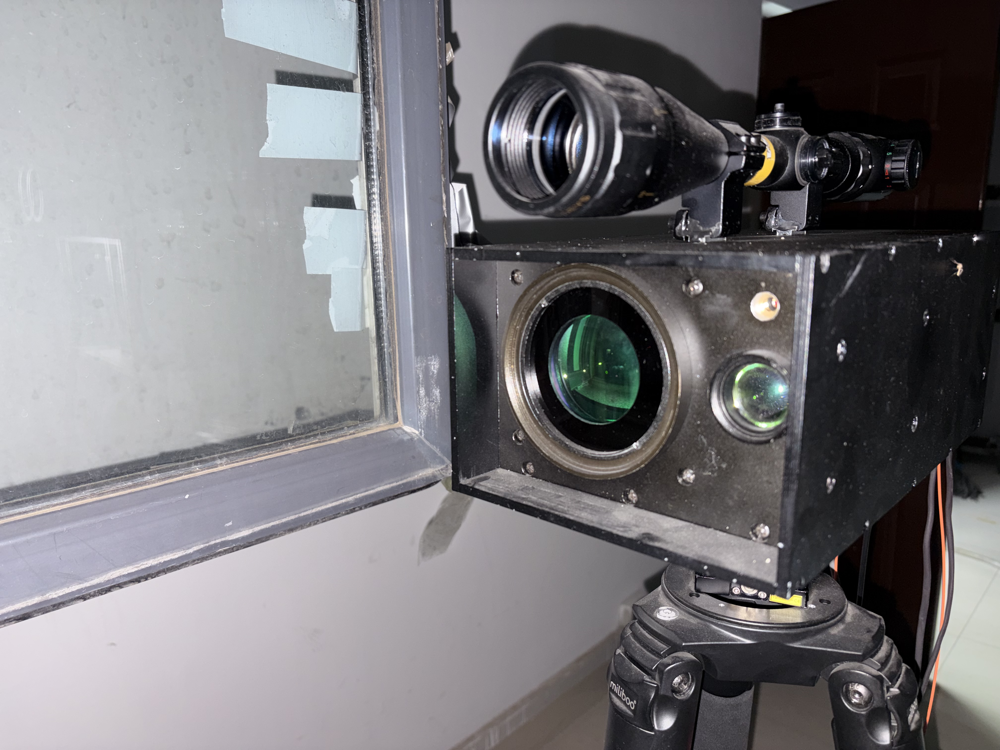](fso-field-experiment/images/fso_optical_terminal_closeup_01.jpg) | [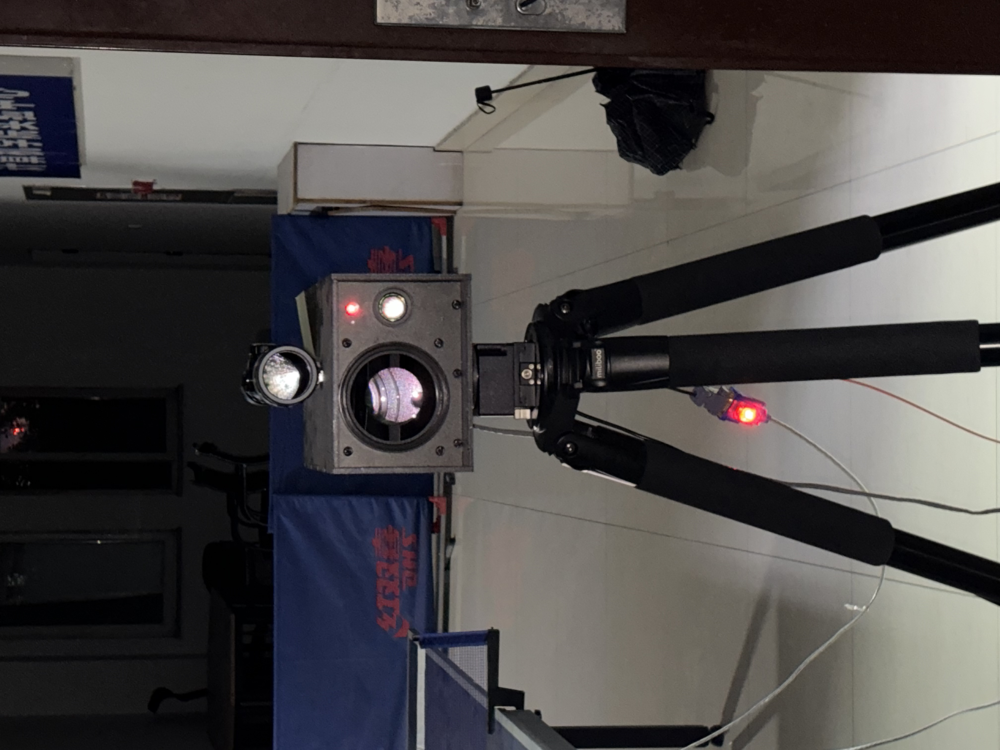](fso-field-experiment/images/fso_optical_terminal_closeup_02.jpg) |
| **Optical terminal close-up 01** | **Optical terminal close-up 02** |
| [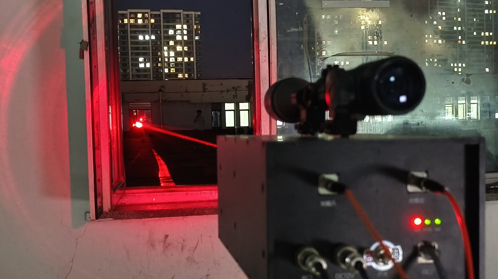](fso-field-experiment/images/fso_optical_terminal_closeup_03.jpg) | [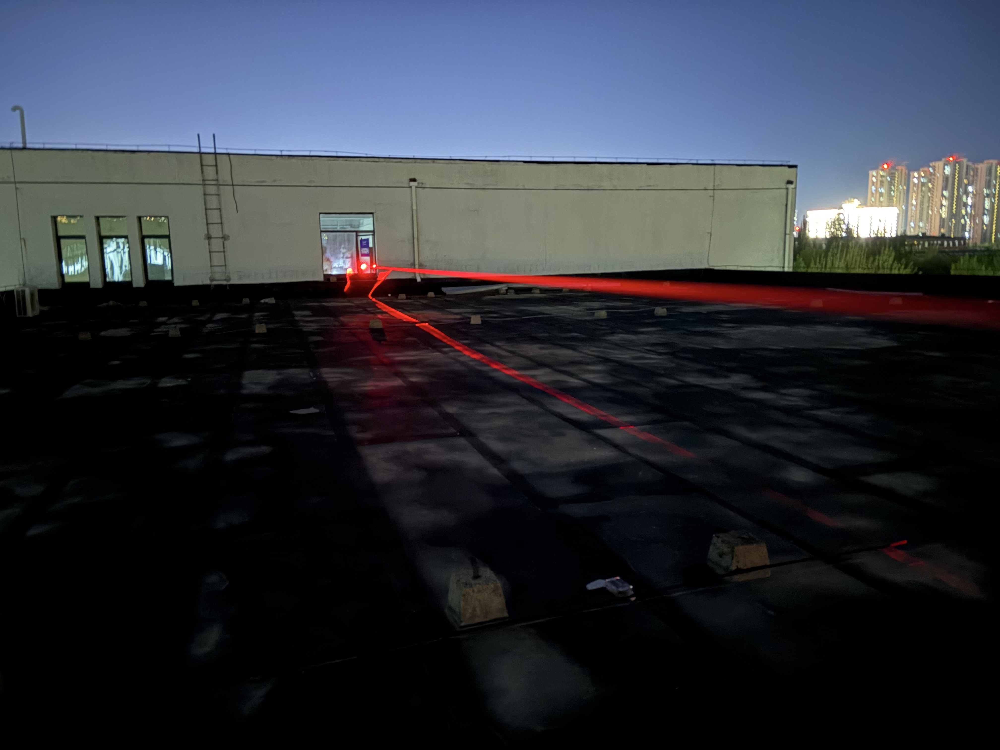](fso-field-experiment/images/fso_rooftop_link_overview_01.jpg) |
| **Optical terminal close-up 03** | **Rooftop link overview 01** |
| [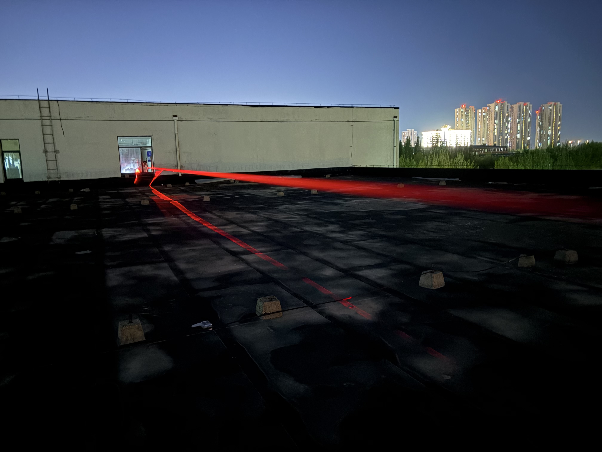](fso-field-experiment/images/fso_rooftop_link_overview_02.jpg) | |
| **Rooftop link overview 02** | |

### Measurement plots

| | |
|---|---|
| [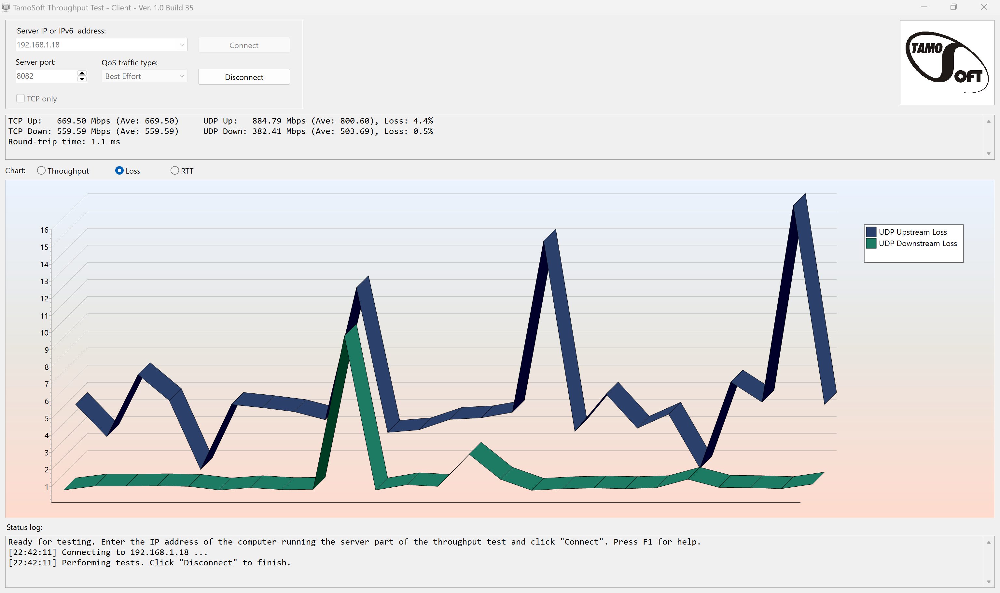](fso-field-experiment/images/Loss_1.png) | [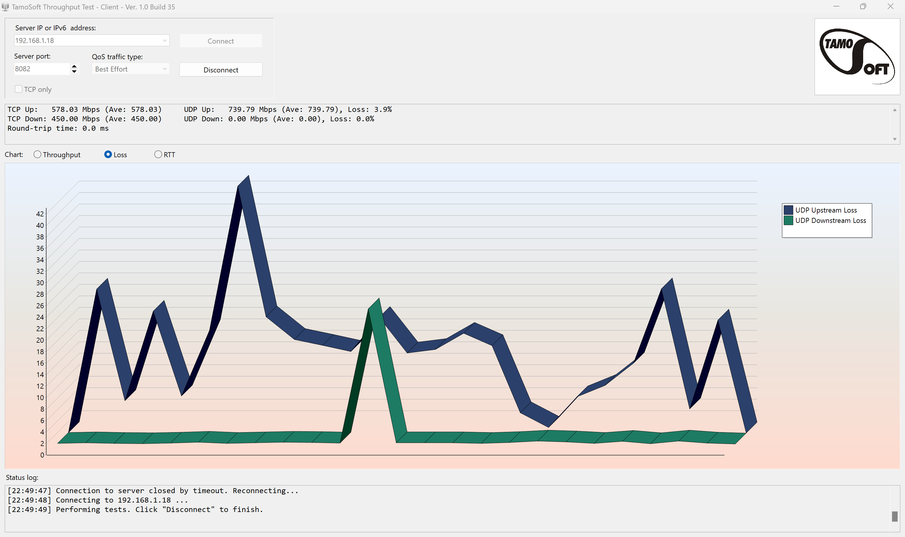](fso-field-experiment/images/Loss_2.png) |
| **Loss 1** | **Loss 2** |
| [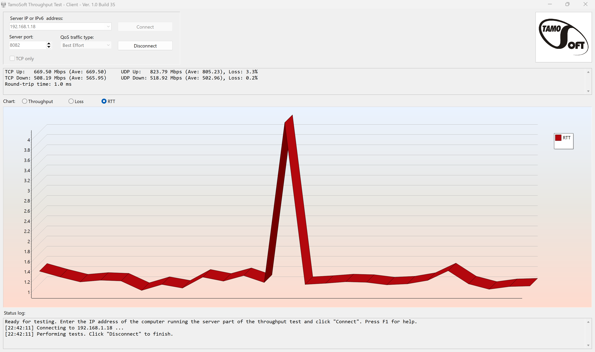](fso-field-experiment/images/RTT_1.png) | [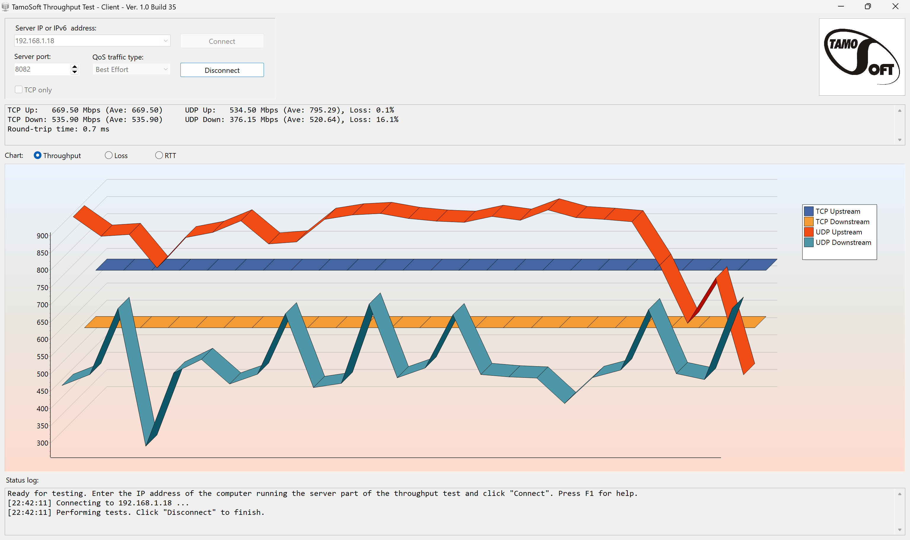](fso-field-experiment/images/Throughput_1.png) |
| **RTT 1** | **Throughput 1** |
| [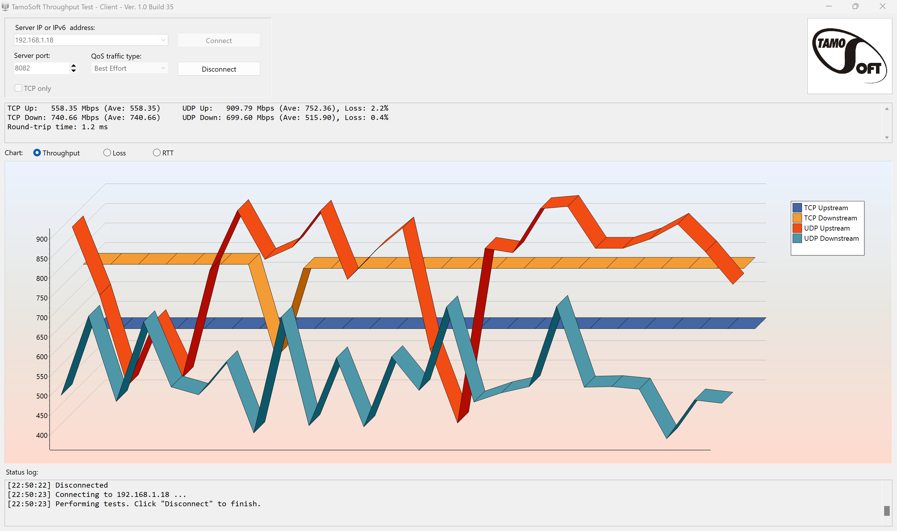](fso-field-experiment/images/Throughput_2.png) | [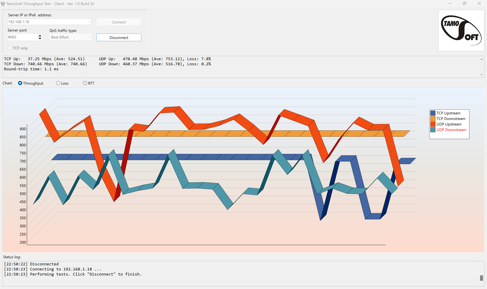](fso-field-experiment/images/Throughput_3.png) |
| **Throughput 2** | **Throughput 3** |

### Video and runnable prototype demos

- [▶ Open the complete received optical-power fluctuation video (MP4)](fso-field-experiment/videos/power%20fluctuation_01.mp4)
- [▶ Launch the SecurIR Python host GUI](securir-comms/host/gui_app.py) — install the requirements and run the commands in [Run the SecurIR prototype](#run-the-securir-prototype).
- [▶ ESP32 transmitter demo (Arduino)](securir-comms/firmware/arduino/tx/tx.ino)
- [▶ ESP32 receiver demo (Arduino)](securir-comms/firmware/arduino/rx/rx.ino)
- [▶ ESP-IDF transmitter implementation](securir-comms/firmware/tx/main/main.c)
- [▶ ESP-IDF receiver implementation](securir-comms/firmware/rx/main/main.c)
- [Complete hardware and demo run guide](securir-comms/docs/run_guide.md)

### FSO field materials

The `fso-field-experiment/` directory contains:

- 11 image files: six PNG measurement plots and five JPG photographs.
- 1 MP4 showing received optical-power fluctuation.
- The upstream README and placeholder files.

These files document an FSO field-experiment setting. They are included on the repository owner's representation that they own the relevant image and video rights. The upstream source and exact captured commit remain recorded. The materials are not relicensed here; reuse requires permission from the rights holder.

### SecurIR communications prototype

The `securir-comms/` directory contains:

- ESP32 transmitter and receiver firmware for Arduino IDE and ESP-IDF.
- OOK/Manchester framing, CRC, and optional Hamming(7,4) helpers.
- A Python serial GUI, logging, protocol, and FEC utilities.
- Hardware, code-structure, run, and test-plan documentation.

This component remains under its upstream MIT License. The original license is preserved at [`securir-comms/LICENSE`](securir-comms/LICENSE), and upstream author/source attribution is retained.

## Run the SecurIR prototype

The commands below are run from the SecurIR component directory:

```bash
cd securir-comms
python -m pip install -r requirements.txt
python host/gui_app.py
```

For firmware, open `securir-comms/firmware/arduino/tx/tx.ino` and `securir-comms/firmware/arduino/rx/rx.ino` in Arduino IDE, select an ESP32 board and the appropriate serial port, then upload each sketch to its respective board. The complete hardware, flashing, serial-port, and troubleshooting instructions are in [`securir-comms/docs/run_guide.md`](securir-comms/docs/run_guide.md).

## Scope and status

The repository title describes the intended LightWing project direction. The imported sources establish two separate building blocks: FSO field materials and an ESP32 indoor line-of-sight optical-link prototype. This repository does **not** claim that these components have been integrated into a drone, that environmental mapping is implemented, or that a combined system has completed flight testing. Any such integration or validation should be documented only after it is implemented and supported by reproducible evidence.

## Safety

Follow the upstream electrical and optical safety guidance. Do not exceed emitter current or thermal limits, and avoid eye exposure to high-power infrared sources.

## Licensing and attribution

- `securir-comms/`: MIT License; upstream repository and author/maintainer account [`Hiresh444`](https://github.com/Hiresh444) are credited above, and the original license text is preserved.
- `fso-field-experiment/`: all-rights-reserved media as stated in its upstream README; no new license is granted by this aggregation.
- Root-level documentation added for this aggregation does not alter the license or ownership of either imported component.
